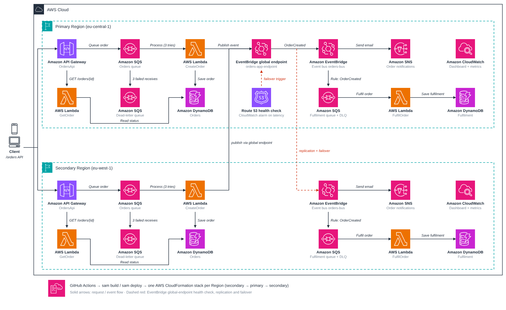

# Project 4 – Event-Driven Orders Application (AWS SAM, multi-Region)

Orders come in through API Gateway, are queued in SQS, processed idempotently by Lambda, announced as events on
Amazon EventBridge (through a **global endpoint**), fanned out to a fulfilment queue and an SNS topic, and the whole
application runs in **two AWS Regions**. It is deployed from your computer or, on every push to `main`, from GitHub Actions.

> **Status.** The stacks have been **deployed successfully in both Regions** through GitHub Actions (secondary →
> primary with the global endpoint → secondary). Getting there took a few fixes that are now in the template: see §8
> *Troubleshooting*. The idempotency / concurrency / batch-failure logic of the Lambda code passes an in-memory test.
> The runtime tests in §4.5 (orders, dead-letter queue, replication, dashboard) are the next thing to run; §7 lists what
> is still unverified.

---

## 1. Project scope and AWS services

### 1.1 What it does



*Solid arrows: requests and events. Dashed red: health check, replication and failover. `GetOrder` answers `GET /orders/{orderId}` (the status check after the 202). Each Region also has a CloudWatch dashboard. Editable vector version: [`docs/architecture.svg`](docs/architecture.svg).*


The **same stack is deployed in both Regions**, so each Region has its own API Gateway, Lambda functions, event bus, SQS queues,
SNS topic, DynamoDB tables and dashboard. The global endpoint and the Route 53 health check are created once, in the primary Region
(red dashed lines = replication and failover). Orders are created through the API Gateway of one Region; the global endpoint
decides which Region's bus receives the `OrderCreated` events.

| Item | Detail |
|---|---|
| **Write path** | `POST /orders` → API Gateway validates the JSON → message on SQS → API answers **202 Accepted** immediately (it does not wait for Lambda). |
| **Idempotency** | The client sends a unique `orderId`. CreateOrder claims it with a DynamoDB conditional write; duplicates return the stored result and trigger no second event. |
| **Events** | After the order is stored, CreateOrder publishes `OrderCreated` through the EventBridge global endpoint. |
| **Fan-out** | Rule 1 → SQS → **FulfilOrder** Lambda → *Fulfilment* table. Rule 2 → **SNS** topic (optional e-mail subscription). |
| **Failure handling** | Source queue has a dead-letter queue: after **3** failed receives a message is moved there. The fulfilment queue has one too. |
| **Read path** | `GET /orders/{orderId}` → Lambda → order status + fulfilment record (the client polls this after the 202). |
| **Observability** | CloudWatch dashboard: EventBridge `MatchedEvents`, SQS `NumberOfMessagesSent`, SNS `NumberOfMessagesPublished` (+ DLQ depth); X-Ray tracing on Lambda. |
| **Disaster recovery** | EventBridge **global endpoint** + Route 53 health check: if ingestion in the primary Region degrades, publishers are routed to the secondary Region. Replication keeps both buses in step. |
| **Delivery** | GitHub Actions on every push to `main`, credentials from repository secrets. |

### 1.2 Where each requirement lives

| # | Requirement | Implemented in |
|---|---|---|
| 1 | Custom bus + `OrderCreated` event from CreateOrder | `OrderBus`, `src/create-order/index.js` (`publishOrderCreated`) |
| 2 | SQS queue + rule + `FulfilOrder` + new DynamoDB table | `FulfilmentQueue`, `OrderToFulfilmentRule`, `FulfilOrderFunction`, `FulfilmentTable` |
| 3 | SNS topic + rule | `OrderNotificationsTopic`, `OrderNotificationRule` (input transformer builds the message) |
| 4 | CloudWatch dashboard | `OrdersDashboard` |
| 5 | GitHub Actions deployment | `.github/workflows/deploy.yml` |
| 6 | API Gateway → SQS → CreateOrder (async, validated) | `OrdersApi` (JSON-schema model + direct SQS integration), `OrdersQueue`, event source of `CreateOrderFunction` |
| 7 | DLQ, redrive after 3 attempts | `OrdersDeadLetterQueue` + `RedrivePolicy.maxReceiveCount: 3` on `OrdersQueue` |
| 8 | Idempotent processing, no race conditions | `processOrder()` in `src/create-order/index.js` (conditional `PutItem` + lease takeover) |
| 9 | Active-active multi-Region with global endpoints | `RegionRole` parameter, `GlobalEndpoint`, `EndpointHealthCheck`, `EndpointHighLatencyAlarm`, `EndpointReplicationRole`; `EndpointId` passed to `PutEvents` |

### 1.3 AWS services used (short résumé)

| Service | Role |
|---|---|
| **AWS SAM / CloudFormation** | Defines and deploys everything from `template.yaml` (one stack per Region). |
| **Amazon API Gateway (REST)** | Public API; validates requests; writes straight to SQS (no Lambda in the write path). |
| **Amazon SQS** | Orders queue, fulfilment queue, and a dead-letter queue for each. |
| **AWS Lambda (Node.js 22)** | `CreateOrder`, `FulfilOrder`, `GetOrder`. |
| **Amazon DynamoDB** | `orders` table (idempotency + state) and `fulfilment` table. |
| **Amazon EventBridge** | Custom event bus, rules, and the **global endpoint** (with event replication). |
| **Amazon SNS** | Order notification topic (optional e-mail subscriber). |
| **Amazon CloudWatch** | Dashboard, logs (7-day retention), the failover alarm. |
| **Amazon Route 53** | One *health check* (type CloudWatch metric) that tells the global endpoint when to fail over. No hosted zone, no domain. |
| **AWS IAM** | Least-privilege roles (Lambda, API Gateway → SQS, endpoint replication). |
| **AWS X-Ray** | Active tracing on the functions. |
| **Amazon S3** | SAM's managed artifact bucket (one per Region) holding the packaged code. |

---

## 2. Free tier: restrictions you will run into

Short version: **the application is cheap, but it is not 100 % free.** Costs come from EventBridge custom events, and
the multi-Region design multiplies usage. At lab volume (hundreds of orders) expect cents, not dollars.

What I **verified on the AWS pricing pages**:

- **EventBridge custom events: $1.00 per million, no free tier.** Publishing to the global endpoint is a custom event. There is *no extra charge for the global endpoint itself*, but delivery to another event bus is also $1.00 per million, and cross-Region transfer can add data-transfer charges. With replication on, every order is billed roughly twice.
- **Route 53 health check: $0.50 per month** for a CloudWatch-metric health check (billed like an AWS-endpoint check). The same page also says up to 50 AWS-endpoint health checks per account are free, so it may cost nothing; check your bill.

What I am stating from general knowledge (**confirm on the AWS Free Tier page**):

| Service | Free allowance (typical) | Effect here |
|---|---|---|
| Lambda | 1 M requests + 400 000 GB-s / month, always free | Fine. |
| SQS | 1 M requests / month, always free | Fine; EventBridge→SQS deliveries count too. |
| SNS | 1 M publishes, 1 000 e-mail deliveries / month | Fine. |
| DynamoDB | 25 GB + 25 provisioned RCU / 25 WCU | Tables use **provisioned 5/5** (4 tables = 20/20), because *on-demand has no free tier*. Tiny capacity: bursts are throttled and retried through SQS. |
| API Gateway (REST) | 1 M calls / month for the first 12 months (older accounts) | Stage throttled to 10 req/s as a safety net. |
| CloudWatch | 10 alarms, 3 dashboards, basic metrics, 5 GB logs | 1 alarm + 1 dashboard per Region. |
| X-Ray | 100 000 traces / month | Fine. |

Restrictions and traps specific to this project:

1. **Two Regions = double work.** With replication, *both* Regions process every order (two Lambda runs, two fulfilment rows, two notifications). Usage allowances are per account, not per Region, so they are shared.
2. **Duplicate e-mails.** Both Regions' SNS topics publish each order. Subscribe `NotificationEmail` in one Region only, or accept two mails.
3. **Low Lambda concurrency on new accounts** (often 10 in total). `QueueConsumerConcurrency` defaults to **2** so throttled pollers do not drive messages to the DLQ. Check *Service Quotas → Lambda → Concurrent executions*.
4. **Account plan.** Accounts created since mid-July 2025 can be on the credit-based *Free plan*, where some services/features may be restricted until you upgrade. I could not confirm whether EventBridge global endpoints or Route 53 health checks are on its allowed list. If stack creation fails with a plan/permission message, that is the cause (Billing → *Account plan*).
5. **Region support.** Check that your two Regions support global endpoints (defaults `eu-central-1` / `eu-west-1`). The two Regions must be different, and the bus must have the **same name** in both.
6. **True active-active routing is not free.** Sending *client traffic* to both Regions needs Route 53 records (a domain, hosted zone, latency/weighted routing). This project gives you two independent regional API URLs; see §7.
7. **Set a budget alert first:** Billing → *Budgets* → *Zero-spend budget*.

---

## 3. Prerequisites

- An AWS account and an IAM user for deployments, with access keys. Either attach `AdministratorAccess` (simplest for a lab) or the narrower inline policy in `deploy-policy.json` (see §5.2).
- [AWS CLI v2](https://docs.aws.amazon.com/cli/latest/userguide/getting-started-install.html), [AWS SAM CLI](https://docs.aws.amazon.com/serverless-application-model/latest/developerguide/install-sam-cli.html), Node.js 22, Git, a GitHub account.
- **Windows users (PowerShell):** the commands below are single-line so they work in PowerShell, cmd and bash. Use `curl.exe` (not the `curl` alias). Build with Docker: `sam build --use-container` (needs Docker Desktop), because the CreateOrder function includes a native library (AWS CRT) that must be built for Linux. Deploying through GitHub Actions (§5) avoids this entirely.

Project layout:

```
.
├── template.yaml                  # all AWS resources (steps 1-4, 6-9)
├── samconfig.toml                 # stack name, Regions, defaults for sam deploy
├── deploy-policy.json             # IAM policy for the deployment user (alternative to AdministratorAccess)
├── events/order.json              # sample request body (+ invalid-order.json for the 400 test)
├── src/
│   ├── create-order/              # CreateOrder (idempotent, publishes via global endpoint) + package.json and package-lock.json (CRT)
│   ├── fulfil-order/              # FulfilOrder (SQS consumer)
│   └── get-order/                 # GET /orders/{orderId}
├── docs/architecture.png          # architecture diagram (+ architecture.svg, vector)
├── .github/
│   ├── workflows/deploy.yml       # CI/CD (step 5)
│   └── dependabot.yml             # weekly dependency update PRs (npm + GitHub Actions)
└── README.md
```

---

## 4. Deploy procedure – AWS (from your computer)

Region names below are the defaults (`eu-central-1` = **primary**, `eu-west-1` = **secondary**); change them in
`samconfig.toml` if you like.

### Step 4.1 – Configure the AWS CLI

```
aws configure
aws sts get-caller-identity
```

Enter the access key, secret key, default region `eu-central-1`, output `json`. The second command shows which account you are about to use.

### Step 4.2 – Validate and build

```
sam validate --lint
sam build --use-container
```

(`sam build` without `--use-container` is fine on Linux x86_64.) `sam build` runs `npm install` for each function.

### Step 4.3 – Deploy the primary Region only (single-Region mode, steps 1-8)

This is the safest first run: no global endpoint, no Route 53, events go to the local bus.

```
sam deploy
```

Accept the defaults (stack `orders-app`, IAM role creation **Y**). Add an e-mail for notifications with
`sam deploy --parameter-overrides "RegionRole=primary EnableGlobalEndpoint=false NotificationEmail=you@example.com"`,
then click the confirmation link AWS mails you. Skip to §4.5 to test; come back here for the multi-Region upgrade.

### Step 4.4 – Go multi-Region (step 9): secondary → primary → secondary

The global endpoint needs the event bus of **both** Regions, and the secondary Lambdas need the endpoint id, so the
order is fixed.

**1) Secondary Region first** (creates its bus, queues, API, …):

```
sam deploy --config-env secondary
```

**2) Primary Region, now with the global endpoint** (creates the CloudWatch alarm, Route 53 health check, replication role and the endpoint):

```
sam deploy --parameter-overrides "RegionRole=primary PeerRegion=eu-west-1 EnableGlobalEndpoint=true"
```

Read the endpoint id:

```
aws cloudformation describe-stacks --stack-name orders-app --region eu-central-1 --query "Stacks[0].Outputs[?OutputKey=='GlobalEndpointId'].OutputValue" --output text
```

(The primary CreateOrder already uses it – the id is wired in with `!GetAtt`.)

**3) Secondary Region again**, so its Lambda publishes through the endpoint too (replace `<id>`):

```
sam deploy --config-env secondary --parameter-overrides "RegionRole=secondary PeerRegion=eu-central-1 GlobalEndpointId=<id>"
```

Until step 3 is done the secondary publishes to its own local bus – nothing breaks, it just is not using the endpoint yet.

### Step 4.5 – Test

Get the API URL (repeat with `--region eu-west-1` for the secondary Region):

```
aws cloudformation describe-stacks --stack-name orders-app --region eu-central-1 --query "Stacks[0].Outputs[?OutputKey=='ApiUrl'].OutputValue" --output text
```

**a) Create an order** – answers immediately with `202 Accepted`:

```
curl.exe -i -X POST "<ApiUrl>/orders" -H "Content-Type: application/json" --data "@events/order.json"
```

**b) Check the result** (after a few seconds):

```
curl.exe "<ApiUrl>/orders/ord-1001-demo"
```

You should see `"status":"COMPLETED"` and a `fulfilment` object with `"status":"FULFILLED"`.

**c) Validation** – a body without `customerId` must return `400` and never reach SQS:

```
curl.exe -i -X POST "<ApiUrl>/orders" -H "Content-Type: application/json" --data "@events/invalid-order.json"
```

**d) Idempotency** – send the **same** `events/order.json` three more times (each answers 202). Then confirm there is still exactly one order, one fulfilment row and one notification:

```
aws dynamodb scan --table-name orders-app-fulfilment --select COUNT --region eu-central-1
```

(Change `orderId` in the file to create a different order.)

**e) Dead-letter queue** – put a poison message directly on the queue and watch it move after 3 failed receives (about 3–4 minutes, the visibility timeout is 60 s):

```
aws sqs send-message --queue-url <OrdersQueueUrl output> --message-body "not json" --region eu-central-1
aws sqs get-queue-attributes --queue-url <OrdersDeadLetterQueueUrl output> --attribute-names ApproximateNumberOfMessages --region eu-central-1
```

**f) Multi-Region** – post an order to the **secondary** API URL. Because the event goes through the global endpoint and is replicated, the order record is in the secondary Region's `orders` table, and a fulfilment row appears in **both** Regions' `orders-app-fulfilment` tables.

**g) Dashboard** – open the `DashboardUrl` output (CloudWatch → Dashboards). There is one dashboard per Region, named `orders-app-<region>-dashboard` (dashboard names are account-wide, so the Region is part of the name). It shows MatchedEvents, NumberOfMessagesSent, NumberOfMessagesPublished and the dead-letter queues. Metrics appear after a few minutes.

---

## 5. Deploy procedure – GitHub (automatic on every push to `main`)

### Step 5.1 – Create the repository and push

```
git init -b main
git add .
git commit -m "Orders event-driven application"
git remote add origin https://github.com/<your-user>/<your-repo>.git
git push -u origin main
```

Never commit AWS keys (`.gitignore` already excludes `.aws-sam/` and `node_modules/`).

### Step 5.2 – Create deployment credentials in AWS

IAM → Users → *Create user* (for example `github-sam-deployer`) → give it permissions, either:

- **`AdministratorAccess`** (simplest, lab only), or
- **the inline policy in `deploy-policy.json`**: *Add permissions → Create inline policy → JSON*, paste the file. It allows CloudFormation, Lambda, API Gateway, SQS, SNS, EventBridge, DynamoDB, CloudWatch/Logs, Route 53 and X-Ray, S3 only for SAM's artifact buckets, and IAM only for roles named `orders-app-*`. If a deployment fails with `AccessDenied`, the log names the missing action: add it to the policy.

Then *Security credentials* → *Create access key* (use case: *Application running outside AWS*).

Without enough permissions the first deployment fails in `ROLLBACK_FAILED`, which needs manual clean-up (§8).

### Step 5.3 – Store them as GitHub repository secrets

Repository → *Settings → Secrets and variables → Actions*:

| Type | Name | Value |
|---|---|---|
| **Secret** | `AWS_ACCESS_KEY_ID` | access key id |
| **Secret** | `AWS_SECRET_ACCESS_KEY` | secret access key |
| Variable (optional) | `PRIMARY_REGION` | default `eu-central-1` |
| Variable (optional) | `SECONDARY_REGION` | default `eu-west-1` |
| Variable (optional) | `MULTI_REGION` | `true` (default) or `false` = single Region, steps 1-8 only |
| Variable (optional) | `NOTIFICATION_EMAIL` | address for the SNS subscription |

### Step 5.4 – What the workflow does

The workflow ignores pushes that only change `*.md` files or `docs/`, so README edits do not trigger a deployment (run it by hand from the *Actions* tab if you ever need to).

`.github/workflows/deploy.yml` runs on every push to `main` (and manually: *Actions → Run workflow*):

1. check out, set up Node 22 and SAM CLI, load the AWS credentials from the secrets
2. `sam validate --lint`, then `sam build` (packages every function with its npm dependencies)
3. `sam deploy` **secondary → primary → secondary (again, only if the endpoint id changed)** – the same order as §4.4
4. prints the outputs of both stacks

If a `sam deploy` fails, the workflow also prints a **diagnostics** block: the stack status, the failed stack events (the earliest `CREATE_FAILED` is the root cause) and, for change-set failures, the validation events. Read that block first.

Pushing a change to a Lambda file re-packages and updates that function; pushing a template change updates the stacks. An unchanged push ends green (`--no-fail-on-empty-changeset`). The first run takes a few minutes longer (endpoint creation).

> Hardening for later: replace long-lived access keys with GitHub OIDC and an IAM role; pin actions to commit SHAs.

---

## 6. Tear down and stop all costs (keep the configuration)

Your **configuration is code** and stays untouched by everything below: `template.yaml`, `src/`, `samconfig.toml`, the workflow, and the GitHub secrets/variables. Redeploying later recreates the whole thing.

### 6.1 What can cost money while idle

An idle stack has almost no cost (queues, SNS, event buses, Lambda are pay-per-use). The only standing items are the Route 53 health check (about $0.50/month, possibly inside its free allowance), the DynamoDB provisioned capacity (inside the free 25/25 units), CloudWatch logs/dashboard (tiny) and S3 storage of the packaged code (cents). There is no "pause" button, so for a **guaranteed $0**, delete the stacks.

### 6.2 Delete everything in AWS

1. **Stop automatic deployments**, so a push cannot recreate the stacks: *Actions → Deploy SAM application → ⋯ → Disable workflow* (or `gh workflow disable deploy.yml`).
2. **(Optional) back up the data** (the tables are deleted with the stacks):
   ```
   aws dynamodb scan --table-name orders-app-orders --region eu-central-1 --output json > orders-backup.json
   aws dynamodb scan --table-name orders-app-fulfilment --region eu-central-1 --output json > fulfilment-backup.json
   ```
3. **Delete the primary stack first** (this removes the global endpoint, Route 53 health check and alarm), **then the secondary**:
   ```
   sam delete --stack-name orders-app --region eu-central-1
   sam delete --stack-name orders-app --region eu-west-1
   ```
   Answer *yes* to also delete the uploaded code in S3. If a delete ends in `DELETE_FAILED`, open CloudFormation → the stack → *Events*, fix what it names (usually a leftover manual resource), and delete again.
4. **Remove SAM's artifact buckets** if no other SAM project uses them (one per Region): S3 → bucket starting with `aws-sam-cli-managed-default-samclisourcebucket-` → *Empty* → then CloudFormation → delete the stack `aws-sam-cli-managed-default` in that Region.
5. **Neutralise the credentials but keep them on file:** IAM → user `github-sam-deployer` → access key → *Make inactive*. (The GitHub secrets can stay as they are.)
6. **Confirm nothing is left** (repeat for both Regions):
   ```
   aws cloudformation list-stacks --region eu-central-1 --stack-status-filter CREATE_COMPLETE UPDATE_COMPLETE --query "StackSummaries[].StackName"
   aws events list-endpoints --region eu-central-1
   aws sqs list-queues --region eu-central-1
   aws dynamodb list-tables --region eu-central-1
   aws logs describe-log-groups --log-group-name-prefix /aws/lambda/orders-app --region eu-central-1
   aws cloudwatch list-dashboards
   ```
   Also look at Billing → *Bills* and *Free Tier usage* the next day. Route 53 → *Health checks* must be empty.

### 6.3 Redeploy later

Re-activate the IAM access key, re-enable the workflow, then push or run it manually – or deploy by hand with §4.4. Stack names, Regions and parameters come from `samconfig.toml`, the workflow and the GitHub variables.

---

## 7. Design notes and known limits

- **Deployment is confirmed; runtime behaviour is not yet.** Still unverified (run §4.5 to find out):
  - **Native CRT library.** `PutEvents` through a global endpoint is signed with SigV4A, which the JavaScript SDK does through `aws-crt` (native code). The Lambda is `x86_64` to match the GitHub runner. If CreateOrder fails at cold start or in `PutEvents` with a CRT / `signature-v4-crt` error, look at its CloudWatch log first (build with `sam build --use-container` if you deploy from your own machine).
  - **Replication role permissions.** AWS did not document the policy; the first deployment failed with *"does not grant EventBridge the PutRule permission"*. The role now allows `PutEvents`, rule/target management on the `orders-bus` rules, and `iam:PassRole` to `events.amazonaws.com`. If the endpoint later reports another access error, add the action it names to `EndpointReplicationRole`.
  - **Dashboard dimensions** for `MatchedEvents` (`EventBusName` + `RuleName`). If a widget stays empty, open the metric in CloudWatch and copy its dimensions.
  - `package.json` uses version ranges (`^3.700.0`), but `package-lock.json` is committed, so builds install the same versions every time. Dependabot opens a weekly pull request when newer versions exist; a merge to `main` redeploys. `aws-crt` downloads or builds a platform-specific binary at install time, which is why the build must run on Linux x86_64 (GitHub Actions, or `sam build --use-container`).
- **Idempotency is regional.** `orders` is a normal regional table. The same `orderId` sent to *both* Regions can be created once per Region (DynamoDB global tables use last-writer-wins, so a conditional write cannot guarantee uniqueness across Regions). Clients should retry against the same Region unless it is down.
- **At-least-once, not exactly-once.** If CreateOrder crashes after publishing but before marking the order `COMPLETED`, the retry publishes the event again. Every event carries `idempotencyKey = orderId`, and FulfilOrder ignores duplicates the same way. A stricter variant would use the transactional-outbox pattern (DynamoDB Streams → EventBridge Pipes).
- **Global endpoints give automatic *ingestion* failover plus replication; they do not route customer traffic.** For real active-active client traffic add a Route 53 latency/weighted record in front of the two API URLs (needs a domain). Event processing, however, is active in both Regions because of replication.
- **Failover/recovery time** documented by AWS for the recommended alarm settings is about 6 minutes (360 s, max 420 s). Producers can see `PutEvents` errors in that window: use retries with backoff.
- **Health-check alarm and quiet traffic.** `HealthCheckTreatMissingData=missing` (default) keeps the last known state when no events flow, so a quiet lab does not fail over. Set `breaching` only for steady production traffic.
- Order messages go through a *standard* SQS queue (at-least-once, unordered); that is why the consumer is idempotent.
- The earlier DAX / API-cache design of this project is not part of these nine steps and was removed (DAX bills per hour and needs a VPC). It is no longer in the repository (see the Git history if you need it).

---

## 8. Troubleshooting (problems met during the first deployment)

Always start with the **diagnostics block** at the end of a failed workflow log, or run
`aws cloudformation describe-stack-events --stack-name orders-app --region <region> --query "reverse(StackEvents[?contains(ResourceStatus,'FAILED')].[Timestamp,LogicalResourceId,ResourceStatusReason])" --output text`.
The **earliest** `CREATE_FAILED` row is the cause; later "Resource creation cancelled" rows are side effects.

| Symptom | Cause | Fix |
|---|---|---|
| `AccessDenied ... not authorized to perform: sqs:CreateQueue / SNS:GetTopicAttributes / events:DescribeEventBus` | The deployment IAM user lacks permissions. The rollback then fails too. | Attach `AdministratorAccess` or `deploy-policy.json` (§5.2); delete the stuck stack (next row); re-run. |
| Stack in `ROLLBACK_FAILED` or `ROLLBACK_COMPLETE`, or workflow says it cannot update the stack | A failed first creation. Such a stack cannot be updated, only deleted. | CloudFormation → the stack → *Delete* (or `aws cloudformation delete-stack --stack-name orders-app --region <region>`). If it fails on one resource, delete with *retain* for it, then remove that resource by hand. |
| `Failed to create changeset ... AWS::EarlyValidation::ResourceExistenceCheck` | A resource with the same **name** already exists. Names are explicit in this template. | Use the change-set events to find the name: `aws cloudformation list-change-sets --stack-name orders-app --region <region> --query "Summaries[?Status=='FAILED'].ChangeSetId" --output text`, then `aws cloudformation describe-events --change-set-name <id> --region <region>`. Delete the leftover or rename. |
| ... caused by the **dashboard** | CloudWatch dashboard names are account-wide, so the same name in two Regions collides. | Already fixed: the name contains the Region (`orders-app-<region>-dashboard`). |
| ... caused by a leftover **global endpoint** `orders-app-endpoint` in `CREATE_FAILED` | A failed creation can leave the endpoint behind. | `aws events delete-endpoint --name orders-app-endpoint --region <primary>`, wait until `aws events list-endpoints --region <primary>` is empty, re-run. |
| Endpoint `CREATE_FAILED`: *role does not grant EventBridge the PutRule permission* | Replication role too narrow. | Already fixed in the template (§7). |
| `sam validate --lint` fails on the template | cfn-lint treats warnings as errors. | Fix the warning it names (e.g. a parameter default that does not match its pattern). |
| Messages end up in the dead-letter queue although the code is fine | Lambda throttling (low account concurrency) or a poison message. | Check *Service Quotas → Lambda concurrency*; keep `QueueConsumerConcurrency` low; inspect the DLQ message and the function log. |

